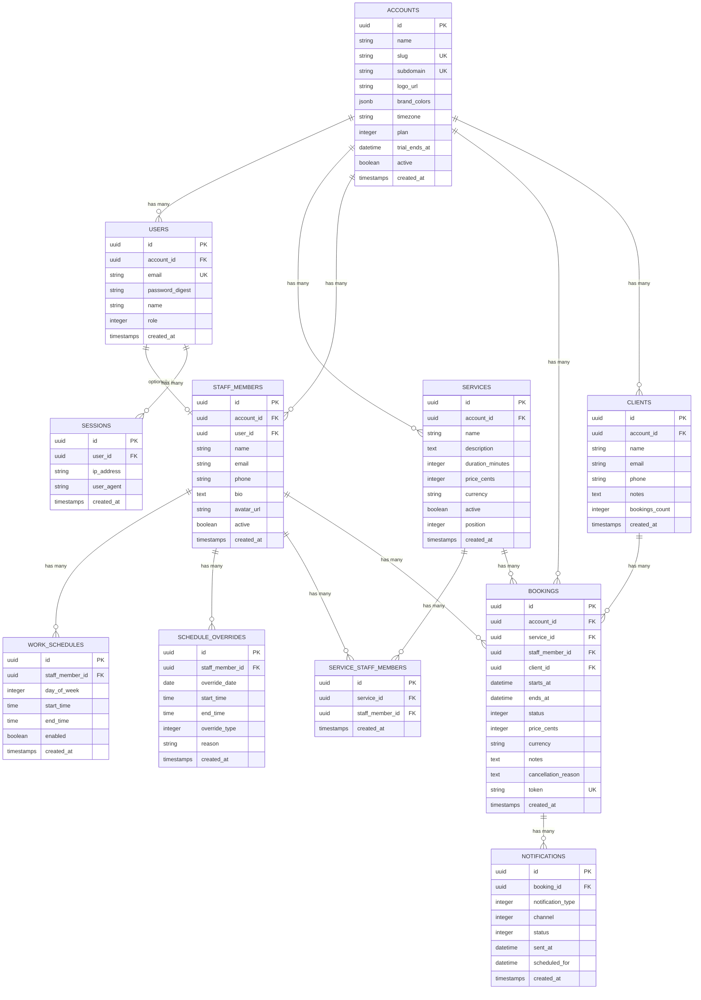
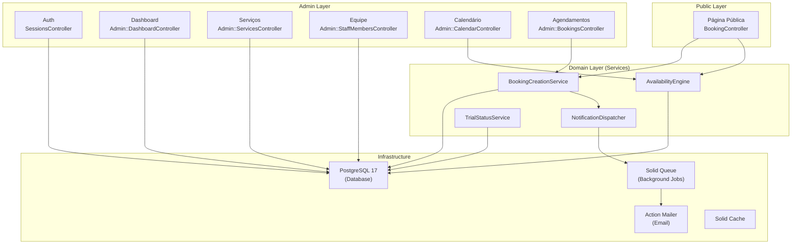

# 🏗️ Plano de Arquitetura — AgendaAI MVP

> **Autor:** Rails Architect
> **Data:** 2026-08-29
> **Baseado em:** [FEATURES.md](file:///home/aluno/agenda-ai/docs/product/FEATURES.md), [ROADMAP.md](file:///home/aluno/agenda-ai/docs/product/ROADMAP.md), [MEETING_NOTES.md](file:///home/aluno/agenda-ai/docs/product/MEETING_NOTES.md)
> **Escopo:** MVP (Semanas 1-6) — 9 features do roadmap NOW

---

## Resumo

Plano técnico completo para o **AgendaAI**, uma plataforma SaaS multi-tenant de agendamento online. O MVP entrega: multi-tenancy com isolamento por `tenant_id`, autenticação nativa do Rails 8, CRUD de serviços e equipe, motor de disponibilidade com proteção contra double-booking, página pública de agendamento mobile-first, calendário admin e notificações por email.

---

## User Review Required

> [!IMPORTANT]
> **Decisões de arquitetura confirmadas pelo usuário:**
> - Multi-tenancy: scoping por `tenant_id` com `acts_as_tenant`
> - Testes: RSpec + FactoryBot + Shoulda Matchers
> - Chave primária: UUID v7
> - Autenticação: Rails 8 Authentication Generator nativo

> [!WARNING]
> **Motor de Disponibilidade** é o componente de maior risco técnico. O plano prevê advisory locks do PostgreSQL para evitar double-booking. Isso requer atenção especial nos testes de concorrência.

---

## Stack Técnica Definitiva

| Camada | Tecnologia | Versão | Justificativa |
|:---|:---|:---:|:---|
| **Linguagem** | Ruby | 3.3+ | Latest stable |
| **Framework** | Rails | 8.0+ | Monolito, Hotwire nativo, Auth generator |
| **Database** | PostgreSQL | 17+ | UUID v7, advisory locks, jsonb |
| **Frontend** | Hotwire (Turbo + Stimulus) | Rails 8 built-in | SPA-like sem complexidade de SPA |
| **CSS** | Tailwind CSS | 4.x | Rapid UI development, design system |
| **Background Jobs** | Solid Queue | Rails 8 built-in | Sem Redis, simplifica infra |
| **Cache** | Solid Cache | Rails 8 built-in | Sem Redis/Memcached |
| **Email** | Action Mailer + Resend | — | API moderna, deliverability alta |
| **Multi-tenancy** | acts_as_tenant | Latest | Scoping automático por tenant_id |
| **Auth** | Rails 8 Auth Generator | Built-in | `has_secure_password`, session-based |
| **Testes** | RSpec + FactoryBot | Latest | Expressividade, coverage |
| **Deploy** | Kamal 2 | Latest | Docker-based, zero-downtime |
| **CI/CD** | GitHub Actions | — | Integração com GitHub |

---

## Schema do Banco de Dados

### Diagrama ER



---

### Detalhamento das Tabelas

#### `accounts` (Tenants)
```ruby
# Cada conta é um tenant isolado
create_table :accounts, id: :uuid do |t|
  t.string   :name,        null: false
  t.string   :slug,        null: false, index: { unique: true }
  t.string   :subdomain,   index: { unique: true }
  t.string   :logo_url
  t.jsonb    :brand_colors, default: {}
  t.string   :timezone,    null: false, default: "America/Sao_Paulo"
  t.integer  :plan,        null: false, default: 0  # enum: trial, starter, professional, business, enterprise
  t.datetime :trial_ends_at
  t.boolean  :active,      null: false, default: true
  t.timestamps
end
```

#### `users` (Autenticação)
```ruby
create_table :users, id: :uuid do |t|
  t.references :account, null: false, foreign_key: true, type: :uuid
  t.string     :email,           null: false
  t.string     :password_digest, null: false
  t.string     :name,            null: false
  t.integer    :role,            null: false, default: 0  # enum: member, admin, owner
  t.timestamps

  t.index [:account_id, :email], unique: true
end
```

#### `sessions`
```ruby
create_table :sessions, id: :uuid do |t|
  t.references :user, null: false, foreign_key: true, type: :uuid
  t.string     :ip_address
  t.string     :user_agent
  t.timestamps
end
```

#### `services`
```ruby
create_table :services, id: :uuid do |t|
  t.references :account, null: false, foreign_key: true, type: :uuid
  t.string     :name,             null: false
  t.text       :description
  t.integer    :duration_minutes, null: false, default: 60
  t.integer    :price_cents
  t.string     :currency,         default: "BRL"
  t.boolean    :active,           null: false, default: true
  t.integer    :position,         null: false, default: 0
  t.timestamps

  t.index [:account_id, :active]
end
```

#### `staff_members`
```ruby
create_table :staff_members, id: :uuid do |t|
  t.references :account, null: false, foreign_key: true, type: :uuid
  t.references :user,    foreign_key: true, type: :uuid  # nullable: convite pendente
  t.string     :name,    null: false
  t.string     :email,   null: false
  t.string     :phone
  t.text       :bio
  t.string     :avatar_url
  t.boolean    :active,  null: false, default: true
  t.timestamps

  t.index [:account_id, :email], unique: true
end
```

#### `service_staff_members` (Join table)
```ruby
create_table :service_staff_members, id: :uuid do |t|
  t.references :service,      null: false, foreign_key: true, type: :uuid
  t.references :staff_member, null: false, foreign_key: true, type: :uuid
  t.timestamps

  t.index [:service_id, :staff_member_id], unique: true
end
```

#### `work_schedules` (Horários regulares)
```ruby
create_table :work_schedules, id: :uuid do |t|
  t.references :staff_member, null: false, foreign_key: true, type: :uuid
  t.integer    :day_of_week,  null: false  # 0=dom, 1=seg, ..., 6=sab
  t.time       :start_time,   null: false
  t.time       :end_time,     null: false
  t.boolean    :enabled,      null: false, default: true
  t.timestamps

  t.index [:staff_member_id, :day_of_week]
end
```

#### `schedule_overrides` (Bloqueios/Exceções)
```ruby
create_table :schedule_overrides, id: :uuid do |t|
  t.references :staff_member,  null: false, foreign_key: true, type: :uuid
  t.date       :override_date, null: false
  t.time       :start_time     # null = dia inteiro
  t.time       :end_time       # null = dia inteiro
  t.integer    :override_type, null: false, default: 0  # enum: block, available
  t.string     :reason
  t.timestamps

  t.index [:staff_member_id, :override_date]
end
```

#### `clients` (Clientes do tenant)
```ruby
create_table :clients, id: :uuid do |t|
  t.references :account, null: false, foreign_key: true, type: :uuid
  t.string     :name,    null: false
  t.string     :email,   null: false
  t.string     :phone
  t.text       :notes
  t.integer    :bookings_count, null: false, default: 0  # counter_cache
  t.timestamps

  t.index [:account_id, :email], unique: true
end
```

#### `bookings` (Agendamentos)
```ruby
create_table :bookings, id: :uuid do |t|
  t.references :account,      null: false, foreign_key: true, type: :uuid
  t.references :service,      null: false, foreign_key: true, type: :uuid
  t.references :staff_member, null: false, foreign_key: true, type: :uuid
  t.references :client,       null: false, foreign_key: true, type: :uuid
  t.datetime   :starts_at,    null: false
  t.datetime   :ends_at,      null: false
  t.integer    :status,       null: false, default: 0  # enum: pending, confirmed, completed, cancelled, no_show
  t.integer    :price_cents
  t.string     :currency,     default: "BRL"
  t.text       :notes
  t.text       :cancellation_reason
  t.string     :token,        null: false, index: { unique: true }  # para link de cancelamento
  t.timestamps

  t.index [:staff_member_id, :starts_at, :ends_at]  # critical: availability queries
  t.index [:account_id, :starts_at]
  t.index [:client_id]
end
```

#### `notifications`
```ruby
create_table :notifications, id: :uuid do |t|
  t.references :booking,           null: false, foreign_key: true, type: :uuid
  t.integer    :notification_type, null: false  # enum: confirmation, reminder_24h, cancellation
  t.integer    :channel,           null: false, default: 0  # enum: email, whatsapp (future)
  t.integer    :status,            null: false, default: 0  # enum: pending, sent, failed
  t.datetime   :sent_at
  t.datetime   :scheduled_for
  t.timestamps

  t.index [:booking_id, :notification_type, :channel], unique: true
  t.index [:status, :scheduled_for]  # for background job queries
end
```

---

## Arquitetura de Componentes

### Diagrama de Arquitetura



---

## Componentes Principais

### 1. Multi-tenancy com `acts_as_tenant`

```ruby
# app/models/concerns/tenant_scoped.rb
module TenantScoped
  extend ActiveSupport::Concern

  included do
    acts_as_tenant(:account)
    belongs_to :account
  end
end
```

**Aplicado a:** `User`, `Service`, `StaffMember`, `Client`, `Booking`, `Notification`

**Controller concern:**
```ruby
# app/controllers/concerns/set_current_account.rb
module SetCurrentAccount
  extend ActiveSupport::Concern

  included do
    before_action :set_current_account
  end

  private

  def set_current_account
    ActsAsTenant.current_tenant = current_user.account
  end
end
```

---

### 2. Motor de Disponibilidade (`AvailabilityEngine`)

> [!CAUTION]
> Este é o componente de **maior risco técnico**. Double-booking pode destruir a confiança no produto.

```ruby
# app/services/availability_engine.rb
class AvailabilityEngine
  # Calcula slots disponíveis para um staff_member em uma data
  # 1. Busca work_schedule do dia da semana
  # 2. Aplica schedule_overrides (bloqueios/exceções)
  # 3. Remove slots já ocupados por bookings (confirmed/pending)
  # 4. Retorna array de TimeSlot (start_time, end_time)
  
  def available_slots(staff_member:, date:, service:)
    # ...
  end

  # Para a página pública: próximos N dias com disponibilidade
  def next_available_dates(staff_member:, service:, days_ahead: 30)
    # ...
  end
end
```

**Proteção contra double-booking:**
```ruby
# app/services/booking_creation_service.rb
class BookingCreationService
  def call(params)
    ActiveRecord::Base.transaction do
      # Advisory lock baseado no staff_member_id + data
      # Impede que duas transações criem booking no mesmo slot
      lock_key = Digest::MD5.hexdigest("booking:#{params[:staff_member_id]}:#{params[:starts_at]}")
      
      ActiveRecord::Base.connection.execute(
        "SELECT pg_advisory_xact_lock(#{lock_key.to_i(16) % (2**63)})"
      )
      
      # Verifica disponibilidade dentro da transação (com lock)
      raise SlotUnavailableError unless slot_available?(params)
      
      booking = Booking.create!(params)
      NotificationDispatcher.new(booking).dispatch_confirmation
      booking
    end
  end
end
```

---

### 3. Estrutura de Diretórios

```
app/
├── controllers/
│   ├── application_controller.rb
│   ├── concerns/
│   │   ├── set_current_account.rb
│   │   └── authentication.rb
│   ├── sessions_controller.rb
│   ├── registrations_controller.rb
│   ├── passwords_controller.rb
│   ├── public/
│   │   └── booking_controller.rb        # Página pública (sem auth)
│   └── admin/
│       ├── base_controller.rb            # Herda ApplicationController + auth
│       ├── dashboard_controller.rb
│       ├── services_controller.rb
│       ├── staff_members_controller.rb
│       ├── work_schedules_controller.rb
│       ├── bookings_controller.rb
│       └── calendar_controller.rb
├── models/
│   ├── concerns/
│   │   └── tenant_scoped.rb
│   ├── account.rb
│   ├── user.rb
│   ├── session.rb
│   ├── service.rb
│   ├── staff_member.rb
│   ├── service_staff_member.rb
│   ├── work_schedule.rb
│   ├── schedule_override.rb
│   ├── client.rb
│   ├── booking.rb
│   └── notification.rb
├── services/
│   ├── availability_engine.rb
│   ├── booking_creation_service.rb
│   ├── notification_dispatcher.rb
│   └── trial_status_service.rb
├── jobs/
│   ├── send_booking_confirmation_job.rb
│   ├── send_reminder_job.rb
│   └── expire_trials_job.rb
├── mailers/
│   ├── booking_mailer.rb
│   └── account_mailer.rb
├── views/
│   ├── layouts/
│   │   ├── application.html.erb          # Admin layout
│   │   └── public.html.erb              # Public booking layout
│   ├── public/
│   │   └── booking/
│   │       ├── show.html.erb            # Landing do tenant
│   │       ├── _service_selection.html.erb
│   │       ├── _staff_selection.html.erb
│   │       ├── _calendar.html.erb
│   │       └── _confirmation.html.erb
│   └── admin/
│       ├── dashboard/
│       ├── services/
│       ├── staff_members/
│       ├── bookings/
│       └── calendar/
└── javascript/
    └── controllers/                     # Stimulus controllers
        ├── calendar_controller.js
        ├── booking_flow_controller.js
        ├── time_slot_controller.js
        └── notification_controller.js
```

---

### 4. Rotas

```ruby
# config/routes.rb
Rails.application.routes.draw do
  # Auth (Rails 8 native)
  resource  :session, only: [:new, :create, :destroy]
  resource  :registration, only: [:new, :create]
  resource  :password, only: [:new, :create, :edit, :update]

  # Página pública de agendamento (sem auth)
  get  "/:slug", to: "public/booking#show", as: :public_booking
  get  "/:slug/availability", to: "public/booking#availability"  # Turbo Frame
  post "/:slug/book", to: "public/booking#create"
  get  "/:slug/confirmation/:token", to: "public/booking#confirmation"
  patch "/:slug/cancel/:token", to: "public/booking#cancel"

  # Admin (com auth)
  namespace :admin do
    root to: "dashboard#show"
    
    resources :services do
      member { patch :toggle_active }
    end
    
    resources :staff_members do
      resources :work_schedules, only: [:index, :update]
      resources :schedule_overrides, only: [:index, :create, :destroy]
    end
    
    resources :bookings do
      member do
        patch :confirm
        patch :cancel
        patch :complete
        patch :no_show
      end
    end
    
    resource :calendar, only: [:show]  # Turbo Frame: day/week/month views
    
    # API interna para Turbo
    namespace :api do
      get "availability/:staff_member_id/:date", to: "availability#show"
    end
  end
end
```

---

## Proposed Changes

### Fase 1 — Fundação (Semana 1)

#### [NEW] Projeto Rails 8
- Gerar projeto: `rails new agenda-ai --database=postgresql --css=tailwind --skip-jbuilder --skip-test`
- Configurar UUID v7 como PK padrão nos generators
- Instalar e configurar gems essenciais

#### [NEW] Gemfile (gems adicionais ao padrão Rails 8)
```ruby
# Multi-tenancy
gem "acts_as_tenant"

# Testing
group :development, :test do
  gem "rspec-rails"
  gem "factory_bot_rails"
  gem "shoulda-matchers"
  gem "faker"
end

group :test do
  gem "capybara"
  gem "selenium-webdriver"
  gem "database_cleaner-active_record"
end

# Code quality
group :development do
  gem "rubocop-rails-omakase"
  gem "annotaterb"
  gem "letter_opener"
end
```

#### [NEW] Migrations (todas as 11 tabelas do schema)

---

### Fase 2 — Auth + Multi-tenancy (Semana 2)

#### [NEW] `app/models/account.rb`
- Modelo de tenant com validações de slug, planos (enum), trial
- Geração automática de slug a partir do nome

#### [NEW] Auth com Rails 8 Generator
- `bin/rails generate authentication`
- Customizar para multi-tenant (user pertence a account)
- Registro cria account + user (owner)

#### [NEW] `app/controllers/concerns/set_current_account.rb`
- Middleware de tenant scoping para todos os controllers admin

#### [NEW] `app/models/concerns/tenant_scoped.rb`
- Concern reutilizável com `acts_as_tenant`

---

### Fase 3 — CRUD Serviços + Equipe (Semana 3)

#### [NEW] `app/controllers/admin/services_controller.rb`
- CRUD completo com Turbo Frames
- Toggle active/inactive

#### [NEW] `app/controllers/admin/staff_members_controller.rb`
- CRUD com nested work_schedules
- Gestão de horários por dia da semana

#### [NEW] `app/controllers/admin/work_schedules_controller.rb`
- Update em batch dos horários semanais

#### [NEW] `app/controllers/admin/schedule_overrides_controller.rb`
- Criar bloqueios (férias, folgas) e exceções

---

### Fase 4 — Motor de Disponibilidade + Booking (Semana 4)

#### [NEW] `app/services/availability_engine.rb`
- Algoritmo: work_schedule → subtract overrides → subtract existing bookings
- Cache de disponibilidade com Solid Cache (TTL: 5 min)

#### [NEW] `app/services/booking_creation_service.rb`
- Transaction com advisory lock
- Criação de client (find_or_create_by email)
- Dispatch de notificação

#### [NEW] `app/controllers/public/booking_controller.rb`
- Fluxo completo sem autenticação
- Multi-step com Turbo Frames (serviço → staff → data/hora → dados → confirmação)

---

### Fase 5 — Calendário Admin (Semana 5)

#### [NEW] `app/controllers/admin/calendar_controller.rb`
- Visões: dia, semana, mês via Turbo Frames
- Filtro por profissional e serviço

#### [NEW] `app/controllers/admin/bookings_controller.rb`
- Agendamento manual pelo admin
- Transições de status (confirmar, cancelar, concluir, no-show)

#### [NEW] Stimulus controllers para calendário interativo

---

### Fase 6 — Notificações + Trial + Polish (Semana 6)

#### [NEW] `app/mailers/booking_mailer.rb`
- Templates: confirmação, lembrete 24h, cancelamento

#### [NEW] `app/jobs/send_reminder_job.rb`
- Job recorrente via Solid Queue (cron-like)
- Busca bookings de amanhã e envia lembretes

#### [NEW] `app/jobs/expire_trials_job.rb`
- Job diário: desativa accounts com trial expirado

#### [NEW] `app/services/trial_status_service.rb`
- Verificação de status do trial
- Bloqueio de funcionalidades após expiração

---

## Open Questions

> [!IMPORTANT]
> **Subdomínio vs Slug:** O FEATURES.md menciona ambos (`empresa.agendaai.com` ou `agendaai.com/empresa`). Para o MVP, recomendo **slug-based** (`agendaai.com/empresa`) porque:
> - Não requer configuração de DNS wildcard
> - Funciona em qualquer ambiente (dev, staging, prod)
> - Mais simples de implementar
> 
> Subdomínios podem ser adicionados no NEXT como feature premium. **Concorda?**

> [!NOTE]
> **Timezone handling:** Cada `Account` tem seu timezone. Todos os horários serão armazenados em UTC no banco e convertidos para o timezone do tenant na exibição. O `starts_at`/`ends_at` dos bookings sempre em UTC.

---

## Verificação

### Testes Automatizados
```bash
# Rodar toda a suite
bundle exec rspec

# Testes específicos do motor de disponibilidade (alta prioridade)
bundle exec rspec spec/services/availability_engine_spec.rb

# Testes de concorrência para double-booking
bundle exec rspec spec/services/booking_creation_service_spec.rb

# Teste de isolamento multi-tenant
bundle exec rspec spec/models/concerns/tenant_scoped_spec.rb
```

### Testes de Isolamento Multi-tenant
- Criar 2 accounts com dados distintos
- Verificar que queries de um tenant NUNCA retornam dados do outro
- Testar com `ActsAsTenant.without_tenant` para garantir que o default scope funciona

### Testes de Concorrência (Double-booking)
- 10 requests simultâneas para o mesmo slot
- Apenas 1 deve ter sucesso, 9 devem receber `SlotUnavailableError`
- Usar threads em RSpec para simular concorrência real

### Verificação Manual
- [ ] Fluxo completo de agendamento na página pública (mobile)
- [ ] Admin cria serviço → vincula staff → staff aparece na página pública
- [ ] Email de confirmação chega ao cliente e ao profissional
- [ ] Lembrete 24h é enviado automaticamente
- [ ] Calendário admin mostra agendamentos corretos por dia/semana/mês
- [ ] Trial expira após 14 dias e bloqueia funcionalidades
